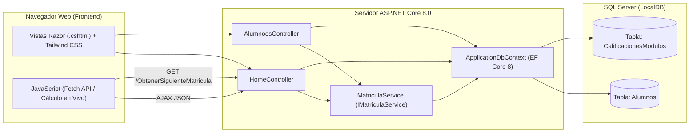
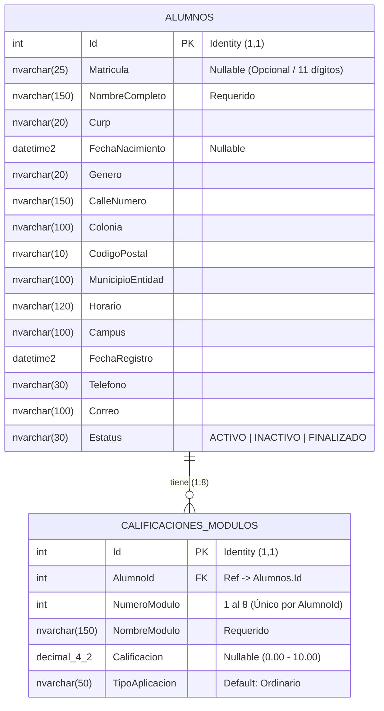

# Documentación Técnica y Funcional del Proyecto
## Sistema Web de Control Escolar — Colegio Profesional de Campeche (CPC)

---

## 1. Información General del Proyecto

| Concepto | Detalle |
| :--- | :--- |
| **Nombre del Sistema** | Sistema Web de Control Escolar (ControlEscolarWeb) |
| **Institución / Organización** | Colegio Profesional de Campeche (CPC) |
| **Contexto Académico** | Proyecto de Residencia Profesional — Ingeniería en Sistemas Computacionales (*Instituto Tecnológico de Campeche / TecNM*) |
| **Autor / Residente** | Alexis Rogerio Campos Esquivel |
| **Arquitectura y Plataforma** | Aplicación Web MVC en ASP.NET Core 8.0 con SQL Server (Entity Framework Core Code-First) |

### 1.1 Problemática y Justificación
Previo a la implementación del sistema, el control de expedientes estudiantiles, asignación de matrículas y seguimiento de calificaciones del plan de bachillerato modular / CENEVAL se gestionaba mediante hojas de cálculo dispersas (`DOCUMENTACION ETAPA 2026.xlsx`) y consultas fragmentadas en el portal heredado (SPACAM). Esto provocaba duplicidad de capturas, lentitud en la atención a alumnos y errores manuales en el cálculo de promedios y consecutivos de matrícula.

### 1.2 Objetivo General
Desarrollar e implementar un sistema web centralizado para la gestión de expedientes estudiantiles, generación automatizada de matrículas institucionales y control académico de los 8 módulos de estudio en el Colegio Profesional de Campeche (CPC).

### 1.3 Objetivos Específicos
1. Centralizar los datos personales, domiciliarios (INE), de contacto y escolares de los alumnos en una base de datos relacional.
2. Automatizar la generación de matrículas institucionales bajo el estándar de 11 dígitos del plantel, permitiendo el registro de alumnos con matrícula en trámite.
3. Proveer un módulo de consulta rápida por matrícula o nombre con visualización en pestañas (*Generales*, *Materias* y *Situación*).
4. Automatizar el cálculo en tiempo real del **Promedio General** y el dictamen de acreditación por módulo.
5. Facilitar la administración completa del padrón estudiantil mediante un directorio general con filtrado dinámico y operaciones CRUD.

---

## 2. Reglas de Negocio (RN)

Las reglas de negocio definen las políticas institucionales del Colegio Profesional de Campeche implementadas en el sistema:

| Código | Nombre de la Regla | Descripción Detallada |
| :--- | :--- | :--- |
| **RN-01** | **Identificación Interna e Independencia de Matrícula** | Todo alumno registrado posee un identificador único interno autoincremental (`Id`). La matrícula escolar (`Matricula`) **no es obligatoria** al momento del alta, pudiendo permanecer nula (`NULL`) cuando se encuentra *"En trámite"*. |
| **RN-02** | **Estructura Oficial de la Matrícula (11 dígitos)** | Cuando se genera una matrícula institucional, debe conformarse exactamente por una cadena numérica de **11 dígitos** con el formato `{AA}{PPP}{CCCCCC}`:<br>• `AA` (2 dígitos): Año en curso (ej. `26` para 2026).<br>• `PPP` (3 dígitos): Código fijo del plan modular (`286`).<br>• `CCCCCC` (6 dígitos): Consecutivo incremental con ceros a la izquierda (`D6`).<br>*Ejemplo:* `26286000196`. |
| **RN-03** | **Consecutivo Base Anual de Matrícula** | Para determinar la siguiente matrícula del año en curso, el sistema busca el consecutivo más alto con el prefijo `{AA}{286}` y le suma `+1`. Si no existen matrículas registradas para ese año y plan, la numeración inicia en el consecutivo base **`196`** (`000196`). |
| **RN-04** | **Plan Académico de 8 Módulos** | Todo expediente estudiantil consta obligatoriamente de **8 módulos (materias)** base:<br>1. Español<br>2. Matemáticas<br>3. Química<br>4. Física<br>5. Historia Universal<br>6. Historia de México<br>7. Biología<br>8. Inglés<br>Si un alumno recién creado o consultado no tiene sus 8 registros de módulos inicializados, el sistema los crea automáticamente. |
| **RN-05** | **Unicidad de Módulo por Alumno** | Un alumno no puede tener duplicado el mismo número de módulo. Existe una restricción única compuesta en base de datos sobre `(AlumnoId, NumeroModulo)`. |
| **RN-06** | **Escala de Calificación** | Las calificaciones se registran en escala numérica de **`0.0` a `10.0`** con soporte para decimales (`decimal(4,2)`). Un módulo sin calificación asignada (`NULL`) se considera en estado **Pendiente**. |
| **RN-07** | **Criterio de Acreditación por Módulo** | • Si `Calificacion >= 6.0`: el módulo se dictamina como **Acreditado**.<br>• Si `Calificacion < 6.0`: el módulo se dictamina como **No Acreditado**.<br>• Si `Calificacion IS NULL`: el módulo permanece como **Pendiente**. |
| **RN-08** | **Cálculo Automático del Promedio General** | El **Promedio General** del alumno se calcula automáticamente promediando únicamente los módulos que ya cuentan con una calificación capturada (excluyendo los módulos pendientes) y redondeando a **1 decimal** (`Math.Round(..., 1)`). Si ningún módulo ha sido evaluado, el promedio se muestra como `-` (*Sin evaluar*). |
| **RN-09** | **Estados de Situación Escolar** | El alumno puede encontrarse en uno de tres estados:<br>• **ACTIVO**: Estudiante que asiste y cursa módulos regularmente.<br>• **INACTIVO**: Baja temporal, baja definitiva o adeudo de documentación.<br>• **FINALIZADO**: Alumno egresado que concluyó satisfactoriamente su plan modular. |
| **RN-10** | **Eliminación en Cascada** | Si un expediente de alumno es eliminado definitivamente del directorio administrativo, sus 8 registros de calificaciones asociados se eliminan en cascada para mantener la integridad referencial. |

---

## 3. Requisitos Funcionales (RF)

### 3.1 Módulo de Acceso y Navegación
- **RF-01. Inicio de Sesión:** El sistema debe permitir la autenticación mediante credenciales administrativas y mantener la sesión activa mediante cookies (`Auth`).
- **RF-02. Cierre de Sesión:** El sistema debe permitir finalizar la sesión activa desde el panel de bienvenida o el buscador, redirigiendo a la pantalla de acceso.
- **RF-03. Panel de Bienvenida:** Tras iniciar sesión, el usuario debe contar con accesos directos hacia la **Búsqueda de Alumno** y el **Directorio General**.

### 3.2 Módulo de Búsqueda y Expediente Rápido (`/Home/Busqueda`)
- **RF-04. Búsqueda por Matrícula o Nombre:** El sistema debe permitir buscar alumnos ingresando su matrícula exacta o coincidencias parciales de su nombre/apellidos.
- **RF-05. Manejo de Múltiples Coincidencias:** Cuando una búsqueda por nombre arroje más de un alumno (ej. apellido *"García"*), el sistema debe listar los resultados coincidentes para que el usuario seleccione el expediente deseado.
- **RF-06. Visualización de Ficha por Pestañas:** El expediente seleccionado debe organizarse en tres secciones sin recargar la página:
  1. **Generales:** Identificación oficial (CURP, fecha de nacimiento, género), domicilio (calle y número, colonia, C.P., municipio/entidad), contacto (teléfono, correo) y datos escolares (horario/grupo, campus, fecha de registro).
  2. **Materias (Calificaciones):** Tabla interactiva de los 8 módulos con captura de calificación, indicador de acreditación y **Promedio General**.
  3. **Situación:** Botones de acción rápida para cambiar el estatus del alumno a *Activo*, *Inactivo* o *Finalizado*.

### 3.3 Módulo de Calificaciones y Promedio Automático
- **RF-07. Captura y Guardado Asíncrono de Calificaciones:** El usuario debe poder capturar o modificar la calificación de cualquiera de los 8 módulos. El guardado debe realizarse vía `Fetch/AJAX` (`POST /Home/GuardarCalificacion`) sin recargar la pantalla ni perder el alumno seleccionado.
- **RF-08. Generación Automática del Promedio General en Tiempo Real:** Al cargar el expediente o al escribir/modificar cualquier calificación en la tabla de módulos, el sistema debe recalcular y mostrar **en automático** el **Promedio General** tanto en la cabecera del expediente como en el encabezado y pie de tabla de la sección de calificaciones, actualizando además la insignia de *Acreditado / No Acreditado / Pendiente*.

### 3.4 Módulo de Generación de Matrícula y Directorio CRUD (`/Alumnoes`)
- **RF-09. Precarga y Botón de Autogeneración de Matrícula:** En el formulario de registro de nuevo alumno (`/Alumnoes/Create`), el sistema debe precargar automáticamente la siguiente matrícula sugerida por `MatriculaService` y ofrecer un botón **"Auto / Generar"** que consulte asíncronamente `/Home/ObtenerSiguienteMatricula` para rellenar el campo sin recargar la página (disponible también en edición).
- **RF-10. Alta de Alumno con o sin Matrícula:** El sistema debe permitir registrar un alumno nuevo con matrícula asignada o dejando el campo vacío (*en trámite*), inicializando automáticamente sus 8 módulos académicos.
- **RF-11. Directorio General con Filtro en Vivo:** La vista `/Alumnoes` debe listar todos los alumnos registrados y permitir filtrar instantáneamente en cliente por nombre, matrícula, CURP, horario o campus.
- **RF-12. Consulta Detallada, Edición y Baja de Expedientes:** El directorio debe permitir consultar la vista completa de detalles (`/Alumnoes/Details/{id}` incluyendo su tabla de calificaciones y promedio general), editar datos generales (`/Alumnoes/Edit/{id}`) y dar de baja registros (`/Alumnoes/Delete/{id}`).

---

## 4. Requisitos No Funcionales (RNF)

| Código | Categoría | Especificación |
| :--- | :--- | :--- |
| **RNF-01** | **Rendimiento y Respuesta** | Las operaciones de búsqueda, cambio de estatus, autogeneración de matrícula y guardado de calificaciones se ejecutan de forma asíncrona (`Fetch API` / JSON) con tiempos de respuesta menores a 1 segundo en red local, evitando recargas completas de página. |
| **RNF-02** | **Usabilidad (UI/UX)** | Interfaz responsiva y limpia construida con **Tailwind CSS** e iconografía **FontAwesome 6**, adaptable a equipos de escritorio y laptops administrativas, con códigos de color semánticos (verde = activo/acreditado, rojo = inactivo/no acreditado, índigo = finalizado/institucional). |
| **RNF-03** | **Integridad de Datos** | Uso de restricciones a nivel de base de datos y modelo: llave primaria `Id` autoincremental, llave foránea `AlumnoId` con borrado en cascada, índice único compuesto `(AlumnoId, NumeroModulo)` y precisión `decimal(4,2)` para calificaciones. |
| **RNF-04** | **Mantenibilidad y Escalabilidad** | Arquitectura en capas basada en el patrón **MVC** (Modelo-Vista-Controlador) con **Inyección de Dependencias (DI)** para servicios de negocio (`IMatriculaService`), facilitando pruebas y mantenimiento. |
| **RNF-05** | **Compatibilidad** | Compatible con cualquier navegador web moderno (Google Chrome, Microsoft Edge, Mozilla Firefox) sobre sistemas operativos Windows 10/11 con .NET 8.0. |
| **RNF-06** | **Portabilidad de Base de Datos** | Gestión del esquema mediante migraciones de **Entity Framework Core (Code-First)** sobre SQL Server / LocalDB, permitiendo replicar la estructura exacta en cualquier entorno de desarrollo o producción. |
| **RNF-07** | **Seguridad Básica** | Protección contra ataques CSRF mediante tokens `[ValidateAntiForgeryToken]` en formularios POST de administración y validación de sesión en los controladores. |

---

## 5. Arquitectura del Sistema y Modelo de Datos

### 5.1 Diagrama de Arquitectura



### 5.2 Diagrama Entidad-Relación (ERD)



---

## 6. Diccionario de Datos

### 6.1 Tabla `Alumnos` (`Models/Alumno.cs`)

| Columna | Tipo SQL | Nulo | Descripción |
| :--- | :--- | :---: | :--- |
| `Id` | `int` (PK, Identity) | No | Identificador único interno del alumno. |
| `Matricula` | `nvarchar(25)` | Sí | Matrícula institucional de 11 dígitos (`{yy}286{consecutivo}`) o `NULL` si está en trámite. |
| `NombreCompleto` | `nvarchar(150)` | No | Nombre(s) y apellidos completos del estudiante. |
| `Curp` | `nvarchar(20)` | No | Clave Única de Registro de Población. |
| `FechaNacimiento` | `datetime2` | Sí | Fecha de nacimiento del alumno. |
| `Genero` | `nvarchar(20)` | No | Género (`Femenino`, `Masculino`, `Otro`). |
| `CalleNumero` | `nvarchar(150)` | No | Calle y número exterior/interior del domicilio. |
| `Colonia` | `nvarchar(100)` | No | Colonia o fraccionamiento. |
| `CodigoPostal` | `nvarchar(10)` | No | Código postal del domicilio. |
| `MunicipioEntidad` | `nvarchar(100)` | No | Municipio y estado de residencia. |
| `Horario` | `nvarchar(120)` | No | Turno o grupo asignado (ej. *Sábado Matutino*, *L-M-V Vespertino*). |
| `Campus` | `nvarchar(100)` | No | Sede escolar (por defecto `"Campus Noceda"`). |
| `FechaRegistro` | `datetime2` | No | Fecha de alta en el sistema. |
| `Telefono` | `nvarchar(30)` | No | Número telefónico de contacto. |
| `Correo` | `nvarchar(100)` | No | Correo electrónico del alumno. |
| `Estatus` | `nvarchar(30)` | No | Estado académico actual (`ACTIVO`, `INACTIVO`, `FINALIZADO`). |

### 6.2 Tabla `CalificacionesModulos` (`Models/CalificacionModulo.cs`)

| Columna | Tipo SQL | Nulo | Descripción |
| :--- | :--- | :---: | :--- |
| `Id` | `int` (PK, Identity) | No | Identificador único del registro de calificación. |
| `AlumnoId` | `int` (FK) | No | Referencia al `Id` del alumno en la tabla `Alumnos`. |
| `NumeroModulo` | `int` | No | Número de módulo del `1` al `8`. Único por alumno. |
| `NombreModulo` | `nvarchar(150)` | No | Nombre oficial de la materia/módulo. |
| `Calificacion` | `decimal(4,2)` | Sí | Calificación obtenida (`0.0` a `10.0`) o `NULL` si está pendiente. |
| `TipoAplicacion` | `nvarchar(50)` | No | Modalidad de evaluación (por defecto `"Ordinario"`). |

---

## 7. Catálogo de Endpoints y Rutas

| Método | Ruta | Controlador / Acción | Descripción |
| :---: | :--- | :--- | :--- |
| `GET` | `/` o `/Home/Index` | `HomeController.Index` | Pantalla de inicio de sesión. |
| `POST` | `/Home/Login` | `HomeController.Login` | Validación de credenciales y creación de cookie de sesión. |
| `GET` | `/Home/Logout` | `HomeController.Logout` | Cierre de sesión. |
| `GET` | `/Home/Bienvenida` | `HomeController.Bienvenida` | Menú principal del sistema. |
| `GET` | `/Home/Busqueda` | `HomeController.Busqueda` | Interfaz de consulta de expedientes, calificaciones y situación. |
| `GET` | `/Home/BuscarAlumno` | `HomeController.BuscarAlumno` | API JSON que busca alumnos por matrícula o nombre. |
| `GET` | `/Home/GetAlumnoDetalle` | `HomeController.GetAlumnoDetalle` | API JSON que devuelve datos del alumno, sus 8 módulos y promedio general. |
| `POST` | `/Home/GuardarCalificacion` | `HomeController.GuardarCalificacion` | API JSON que guarda la nota de un módulo y devuelve el promedio actualizado. |
| `POST` | `/Home/CambiarEstatus` | `HomeController.CambiarEstatus` | API JSON que actualiza el estatus (`Activo`, `Inactivo`, `Finalizado`). |
| `GET` | `/Home/ObtenerSiguienteMatricula` | `HomeController.ObtenerSiguienteMatricula` | API JSON que genera y devuelve la siguiente matrícula institucional de 11 dígitos. |
| `GET` | `/Alumnoes` | `AlumnoesController.Index` | Directorio general de alumnos con filtro en vivo. |
| `GET/POST` | `/Alumnoes/Create` | `AlumnoesController.Create` | Formulario de alta de alumno con matrícula sugerida y creación de 8 módulos. |
| `GET/POST` | `/Alumnoes/Edit/{id}` | `AlumnoesController.Edit` | Edición de datos del expediente estudiantil. |
| `GET` | `/Alumnoes/Details/{id}` | `AlumnoesController.Details` | Vista detallada del expediente con tabla de calificaciones y promedio general. |
| `GET/POST` | `/Alumnoes/Delete/{id}` | `AlumnoesController.Delete` | Confirmación y baja del expediente estudiantil. |

---

## 8. Guía de Sincronización en Git y Base de Datos en Otra Computadora

Cuando se clona el repositorio o se actualiza con `git pull` en otra computadora que tenía una versión anterior de la base de datos local (`ControlEscolarDb`), se deben ejecutar los siguientes comandos en la **Consola del Administrador de Paquetes** (*Package Manager Console*) de Visual Studio:

```powershell
# 1. Eliminar la base de datos local con estructura antigua (si existía)
Drop-Database

# 2. Aplicar todas las migraciones vigentes para crear la estructura actual
Update-Database
```
*(Posteriormente, ejecutar el proyecto con `F5` en Visual Studio).*

